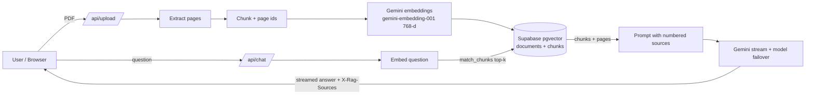

# RAG Doc Chatbot

[](https://nextjs.org/)
[](https://ai.google.dev/)
[](https://supabase.com/)
[](https://vercel.com/)

**Live demo:** [https://rag-doc-chatbot-brown.vercel.app/](https://rag-doc-chatbot-brown.vercel.app/)

Chat with your PDFs and get answers that cite the exact source chunks and pages. A production-style Retrieval-Augmented Generation (RAG) app on free tiers: Google Gemini (`@google/genai`), Supabase pgvector, and Vercel Hobby.

> Portfolio project #1 of 5 on the AI Engineer track.

> **Screenshot:** add a demo GIF or PNG under `docs/` (e.g. `docs/demo.png`) and link it here once you capture the live UI.

## Features

- **Invite-only Auth + mandatory TOTP (AAL2)** — Supabase Auth via `@supabase/ssr`; every page and `/api` route requires MFA-verified session
- **RBAC** — shared `user_roles` table (`admin` | `client`) scoped by `app = 'rag-doc-chatbot'` in the same Supabase project as `job-hunt-agent`
- **PDF upload** — page-aware text extraction (`pdf-parse`), 4 MB cap for Vercel Hobby; documents owned by uploader
- **Chunking** — overlapping word windows (200 words, 40 overlap) that keep page numbers
- **Embeddings** — Gemini `gemini-embedding-001` at **768-dim**, batched via `@google/genai`
- **Vector store** — Supabase Postgres + `pgvector` (HNSW, cosine) with owner-scoped `match_chunks`
- **Streaming chat** — token stream (`text/plain`) with inline `[n]` citations; sources in base64 `X-Rag-Sources`
- **Model fallback** — `GEMINI_CHAT_MODEL` (optional) then `gemini-3.5-flash-lite` → `gemini-3.1-flash-lite` → `gemini-flash-latest` → `gemini-3.6-flash` → `gemini-3.8-flash`, with ~15s TTFT abort per model
- **Timeouts & timing logs** — 45s overall chat budget; Vercel logs emit `[chat] embed_ms` / `retrieval_ms` / generation timing
- **Source panel** — document, page, similarity score, and snippet per citation
- **Grounded answers** — says it doesn't know when the answer isn't in the retrieved sources

## Architecture



## Tech stack

| Layer | Tech |
|---|---|
| Frontend + API | Next.js 14 (App Router, TypeScript), Route Handlers |
| Auth | Supabase Auth + `@supabase/ssr` (cookie sessions), mandatory TOTP MFA (AAL2) |
| LLM + embeddings | `@google/genai` — streaming chat, `gemini-embedding-001` (768-dim) |
| Vector DB | Supabase Postgres + pgvector (HNSW, cosine) |
| Hosting | Vercel Hobby |

## Security & Access Control

### Permission matrix

| Permission | `client` | `admin` |
|---|:---:|:---:|
| `documents:read:own` | ✓ | ✓ |
| `documents:write:own` | ✓ | ✓ |
| `documents:read:any` | | ✓ |
| `documents:write:any` | | ✓ |
| `chat:use` (scoped by ownership unless admin) | ✓ | ✓ |
| `users:manage` (invite / role / disable / remove / reset MFA) | | ✓ |

Helpers live in `lib/auth/permissions.ts` (`can(user, "documents:read:any")`). Service-role DB access still **filters by `owner_id` explicitly** for non-admins; RLS is enabled as defense in depth.

### Auth flow

```mermaid
flowchart TD
  U[Browser] -->|any page/API| MW[Middleware: session + AAL]
  MW -->|no session| L[/login email+password]
  L --> AAL1[Session AAL1]
  AAL1 -->|no TOTP factor| S[/mfa/setup QR + verify]
  AAL1 -->|factor enrolled| V[/mfa/verify TOTP]
  S --> AAL2[Session AAL2]
  V --> AAL2
  AAL2 --> APP[App pages + /api/*]
  APP -->|admin| ADM[/admin/users]
  INV[Admin invite] --> CB[/auth/callback]
  CB --> PW[/auth/set-password]
  PW --> S
```

Invite-only: public signup is disabled in the Supabase dashboard. Bootstrap the first admin with `npm run bootstrap-admin` (uses `ADMIN_EMAIL`; never hardcodes passwords). See [DEPLOYMENT.md](DEPLOYMENT.md) for MFA, redirect URLs, and env vars.

## Engineering decisions & lessons learned

- **Model deprecation / free-tier gaps** — New Gemini keys often cannot call 2.5 models. Chat uses an ordered fallback list (Flash-Lite first) plus optional `GEMINI_CHAT_MODEL`, and aborts slow TTFT so a dead model does not hang the whole request.
- **Latency debugging via timing logs** — `[chat] embed_ms`, `retrieval_ms`, and generation / `total_ms` lines in Vercel Logs separate embedding, retrieval, and LLM time when chat feels stuck.
- **Header encoding** — Putting JSON source snippets in `X-Rag-Sources` crashed on non-ASCII (HTTP ByteString). Sources are now **base64(UTF-8 JSON)** on the server and decoded on the client.

## Local development

```bash
git clone https://github.com/drin-tech-tools/rag-doc-chatbot.git
cd rag-doc-chatbot
cp .env.example .env.local   # see .env.example — publishable key + service role + ADMIN_EMAIL
npm install
npm run bootstrap-admin      # one-time invite + admin role (after migrations)
npm run dev                  # http://localhost:3000 → /login
npm test                     # permission helper unit tests
```

Run SQL migrations `0001_init.sql` and `0002_auth_rbac.sql` against your Supabase project before chatting (see [DEPLOYMENT.md](DEPLOYMENT.md)).

## Deploy

Full step-by-step (Supabase secret keys, Gemini free tier, public GitHub + Vercel Hobby, verify, troubleshooting): **[DEPLOYMENT.md](DEPLOYMENT.md)**.

## Project structure

```
app/
  page.tsx                 # upload + streaming chat UI (AAL2)
  login/ mfa/ auth/        # login, TOTP setup/verify, invite set-password, callback
  admin/users/             # invite-only user management (admin)
  api/upload|chat|admin|auth|me
middleware.ts              # session refresh + AAL2 wall
lib/
  auth/                    # permissions, session, CSRF, rate-limit
  supabase/                # SSR / browser / admin clients
  clients.ts               # Gemini + service-role Supabase
scripts/bootstrap-admin.ts
supabase/migrations/0001_init.sql
supabase/migrations/0002_auth_rbac.sql
DEPLOYMENT.md
```

## Roadmap

- [ ] **Evaluation**: golden Q&A set, retrieval hit-rate/MRR, faithfulness and answer relevance (LLM-as-judge or RAGAS), tracked in CI
- [ ] **Hybrid search**: Postgres full-text (`tsvector`) + vector, fused with Reciprocal Rank Fusion
- [ ] **Reranking**: cross-encoder rerank of the top-20 down to the top-5
- [ ] Multi-turn chat memory
- [ ] Semantic / heading-aware chunking and OCR for scanned PDFs
- [x] Auth + per-user document isolation (Supabase Auth + MFA + RLS)
- [ ] Observability: latency, token cost, and quality dashboard (project #5)

## License

MIT
