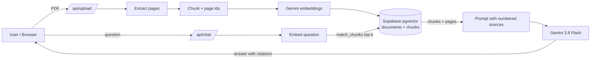

# 📄 RAG Doc Chatbot

Chat with your PDFs and get answers that **cite the exact source chunks and pages**. It's a production-style Retrieval-Augmented Generation (RAG) app that runs entirely on free tiers: Google Gemini API, Supabase pgvector, and Vercel Hobby.

**Live demo:** [https://rag-doc-chatbot-brown.vercel.app/](https://rag-doc-chatbot-brown.vercel.app/)

> Portfolio project #1 of 5 on the AI Engineer track.

## ✨ Features
- **PDF upload**: page-aware text extraction (`pdf-parse`)
- **Chunking**: overlapping word windows (200 words, 40 overlap) that keep page numbers
- **Embeddings**: Gemini `gemini-embedding-001` (768-dim), batched
- **Vector store**: Supabase Postgres + `pgvector` with an HNSW index and a `match_chunks` SQL function
- **Grounded chat**: top-k retrieval, then Gemini `gemini-3.8-flash` with inline `[n]` citations. It says "I don't know" when the answer isn't in the sources.
- **Source panel**: every answer shows the document, page, similarity score, and snippet

## 🏗️ Architecture


## 🧰 Tech Stack
| Layer | Tech |
|---|---|
| Frontend + API | Next.js 14 (App Router, TypeScript), Route Handlers |
| LLM + embeddings | Google Gemini API (free tier) |
| Vector DB | Supabase Postgres + pgvector (HNSW, cosine) |
| Hosting | Vercel Hobby |

## 🚀 Setup
### 1. Supabase
1. Create a free project at [supabase.com](https://supabase.com).
2. Open **SQL Editor**, paste [`supabase/migrations/0001_init.sql`](supabase/migrations/0001_init.sql), and run it.
3. Under **Project Settings → API**, copy the **Project URL** and the **service_role** key. Keep the service_role key server-side only.

### 2. Gemini API key
Get a free key at [aistudio.google.com/apikey](https://aistudio.google.com/apikey).

### 3. Run locally
```bash
git clone https://github.com/drin-tech-tools/rag-doc-chatbot.git
cd rag-doc-chatbot
cp .env.example .env.local   # fill in GEMINI_API_KEY, SUPABASE_URL, SUPABASE_SERVICE_ROLE_KEY
npm install
npm run dev                  # http://localhost:3000
```

### 4. Deploy to Vercel (Hobby)
1. Go to [vercel.com/new](https://vercel.com/new) and import this repo.
2. Add the three environment variables.
3. Click **Deploy**. Uploads are capped at 4 MB to fit Vercel's request body limit.

## 📁 Project Structure
```
app/
  page.tsx              # upload + chat UI
  api/upload/route.ts   # PDF -> chunks -> embeddings -> Supabase
  api/chat/route.ts     # retrieve top-k -> Gemini answer with citations
lib/
  clients.ts            # Gemini + Supabase clients, batch embed
  chunk.ts              # page-aware overlapping chunker
  pdf.ts                # per-page PDF text extraction
supabase/migrations/0001_init.sql
```

## 🗺️ Roadmap
- [ ] **Evaluation**: golden Q&A set, retrieval hit-rate/MRR, faithfulness and answer relevance (LLM-as-judge or RAGAS), tracked in CI
- [ ] **Hybrid search**: Postgres full-text (`tsvector`) + vector, fused with Reciprocal Rank Fusion
- [ ] **Reranking**: cross-encoder rerank of the top-20 down to the top-5
- [ ] Streaming responses and multi-turn chat memory
- [ ] Semantic / heading-aware chunking and OCR for scanned PDFs
- [ ] Auth + per-user document isolation (Supabase Auth + RLS)
- [ ] Observability: latency, token cost, and quality dashboard (project #5)

## 📜 License
MIT
